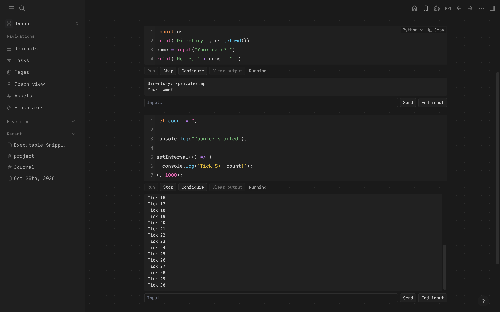

# Executable Snippets

Run Logseq DB code blocks with manageable state and input/output.



## Build and install

Requires desktop Logseq DB 2.0.x on macOS or Linux. Tested with 2.0.2 on macOS.
The helper and Node.js snippets use Logseq’s bundled runtime. Other languages
need their interpreters installed.

Building from source requires Node.js 22+ and npm:

```sh
npm ci
npm run build
```

In Logseq developer mode, **Plugins → Load unpacked plugin** and select this
directory. Open **Executable Snippets: Settings → Automatic startup** and enable
it once. This adds `env` to Logseq’s command allowlist to launch the helper.

Each window starts its own helper automatically. Closing, reloading, or
disabling the plugin stops that window’s snippets. After a lost heartbeat,
cleanup starts within 15 seconds. Untested patch versions show a warning and run
compatibility checks. Other minor versions are blocked because startup uses an
internal API.

## Use

Choose a code language and click **Run**. Templates such as `python3 -u -c $`
receive the snippet as one `$` argument. Nothing runs automatically.

Edit commands through **Executable Snippets: Settings** in the command palette.
**Configure** overrides a block's command or directory. **directory** also
inherits from parent blocks and pages.

Use **Send** for prompts, **End input** for EOF, and **Stop** to terminate the
process group. This uses input/output pipes, not a terminal emulator. Output
stays in memory, limited to 200,000 characters.

Uses Logseq's experimental host-access API. [AGPL-3.0-or-later](LICENSE.md).
